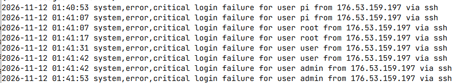

# Así se ve un ataque de fuerza bruta a un MikroTik (y qué hacer)

Caso real: intentos de acceso por SSH contra un router MikroTik expuesto a Internet, análisis del atacante y medidas de endurecimiento aplicadas en RouterOS.

> Los datos de la red defendida (IP pública, identity, rangos de clientes) se omiten a propósito. La IP del atacante sí se publica: ya figura en listas públicas de abuso.

---

## 1. Evidencia



```
2026-11-12 01:40:53 system,error,critical login failure for user pi from 176.53.159.197 via ssh
2026-11-12 01:41:07 system,error,critical login failure for user pi from 176.53.159.197 via ssh
2026-11-12 01:41:07 system,error,critical login failure for user root from 176.53.159.197 via ssh
2026-11-12 01:41:17 system,error,critical login failure for user root from 176.53.159.197 via ssh
2026-11-12 01:41:31 system,error,critical login failure for user user from 176.53.159.197 via ssh
2026-11-12 01:41:42 system,error,critical login failure for user user from 176.53.159.197 via ssh
2026-11-12 01:41:42 system,error,critical login failure for user admin from 176.53.159.197 via ssh
2026-11-12 01:41:53 system,error,critical login failure for user admin from 176.53.159.197 via ssh
```

## 2. Qué está pasando

| Indicador | Lectura |
|---|---|
| Usuarios probados: `pi`, `root`, `user`, `admin` | Diccionario de credenciales por defecto (Raspberry Pi, Linux, routers). No conoce mis usuarios. |
| 2 intentos por usuario | Prueba un par de contraseñas comunes y pasa al siguiente. |
| ~10–15 s entre intentos, 01:40 a.m. | Ritmo automatizado y lento, pensado para no disparar bloqueos simples. |
| Una sola IP de origen | Nodo de escaneo masivo; no es un ataque dirigido. |

**Conclusión:** es un bot que recorre Internet buscando cualquier puerto 22 abierto con credenciales débiles. Si tu SSH está expuesto, te van a llegar estos intentos; es cuestión de minutos.

### ¿Qué quiere el atacante?

Entrar con una credencial débil y apropiarse del equipo para:

- Sumarlo a una **botnet** (ataques DDoS).
- Usarlo como **proxy/SOCKS** para esconder otro tráfico malicioso.
- **Minería** o redirección de tráfico (DNS, scripts inyectados).
- **Pivotear** hacia la red interna y los clientes.

Un router comprometido es especialmente valioso: siempre está encendido, tiene buen ancho de banda y casi nadie lo revisa.

## 3. Inteligencia sobre la IP `176.53.159.197`

| Campo | Valor |
|---|---|
| País (geolocalización) | Turquía |
| ASN | AS154383 – ZORNTECH WEB SOLUTIONS |
| Red | 176.53.159.0/24 |
| Tipo | Hosting / VPS (no se detecta VPN ni Tor) |
| Reputación | Riesgo crítico en feeds de threat intelligence; reportada por SSH brute force, escaneo y reconocimiento |
| Vecinos del /24 | Otras IPs de la misma red aparecen en blocklist.de (ataques SSH) y en reportes de escaneo |

**Interpretación:** lo más probable es un servidor alquilado o comprometido, usado como plataforma de escaneo. La geolocalización indica dónde está el servidor, **no** quién está detrás.

Fuentes:
- [WAYSCloud – 176.53.159.197](https://ip.wayscloud.services/ip-intelligence/176.53.159.197)
- [SANS ISC – red 176.53.159.0/24](https://isc.sans.edu/ipinfo/176.53.159.196)
- [NERD CESNET – 176.53.159.38 (misma red)](https://nerd.cesnet.cz/nerd/ip/176.53.159.38)
- [reportedip.de – 176.53.159.196 (misma red)](https://reportedip.de/ip/176.53.159.196/)

## 4. ¿Entró?

**No.** Todos los intentos terminaron en `login failure`: el bot probó credenciales por defecto y ninguna existía en el router.

Si recibes intentos similares, así puedes revisar tu equipo en busca de **indicadores de compromiso**:

```
/user print                # usuarios que no creé
/user active print         # sesiones activas
/system scheduler print    # tareas programadas extrañas
/system script print       # scripts que no son míos
/ip socks print            # SOCKS habilitado
/ip proxy print            # proxy habilitado
/ip dns static print       # entradas DNS falsas
/file print                # archivos desconocidos
```

> **Tip:** el log por defecto vive en RAM (1000 líneas) y se pierde al reiniciar. Guárdalo en disco o envíalo a un syslog remoto (ver script 04).

## 5. Qué hacer en el MikroTik

Los scripts están en [`scripts/`](scripts). Antes de aplicarlos:

> ⚠️ Activa **Safe Mode** (`Ctrl+X` en terminal o el botón en Winbox). Si te bloqueas, al cerrar la sesión los cambios se revierten.
> ⚠️ Cambia `192.168.88.0/24` por tu red de gestión real.

| Script | Qué hace |
|---|---|
| [`01-bloquear-ip.rsc`](scripts/01-bloquear-ip.rsc) | Agrega la IP y su /24 a una blacklist y la descarta en `raw` (antes del connection tracking, menos CPU). |
| [`02-hardening-servicios.rsc`](scripts/02-hardening-servicios.rsc) | Apaga servicios innecesarios, restringe SSH/Winbox a la red de gestión, cambia el puerto SSH y cierra descubrimiento MAC/neighbor hacia afuera. |
| [`03-firewall-anti-bruteforce.rsc`](scripts/03-firewall-anti-bruteforce.rsc) | Detección por etapas: tras 4 conexiones nuevas en pocos minutos, la IP queda en blacklist 10 días. Además, solo la lista `mgmt` puede tocar los puertos de gestión. |
| [`04-logs-persistentes.rsc`](scripts/04-logs-persistentes.rsc) | Guarda los logs en disco y, opcionalmente, en un syslog remoto. |

### Buenas prácticas adicionales

- No uses el usuario `admin`: crea uno propio con grupo `full` y deshabilita `admin`.
- Contraseñas largas o, mejor, **llaves SSH**.
- Gestión remota solo por **VPN** (WireGuard), nunca con puertos de gestión abiertos a Internet.
- RouterOS actualizado (`/system package update check-for-updates`).
- Revisar periódicamente las listas `ssh_blacklist` y los contadores del firewall.

## 6. Cómo verificar que funciona

```
/ip firewall address-list print where list~"ssh"
/ip firewall filter print stats where comment~"SSH"
/ip firewall raw print stats where comment~"blacklist"
```

Si los contadores de las reglas de drop suben, el router está descartando los intentos antes de que lleguen al login.

## 7. IoC

```
176.53.159.197   SSH brute force   AS154383   TR   2026-11-12
176.53.159.0/24  Red con múltiples reportes de escaneo/SSH brute force
```

---

**Autor:** Anderson Mateo Iglesias Suárez · Administración de redes ISP · Ciberseguridad
